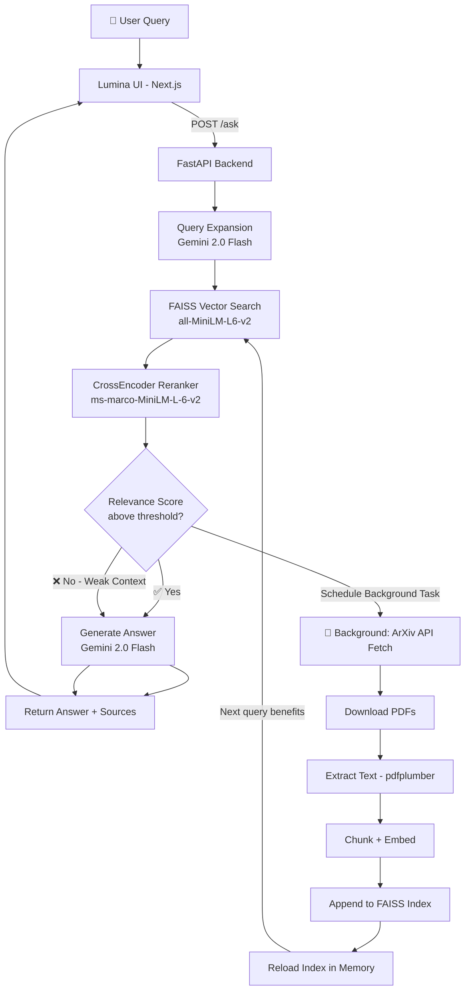

<div align="center">

# 🌌 Lumina
### Autonomous Knowledge Acquisition for Self-Improving Retrieval-Augmented Generation

**A production-grade Retrieval-Augmented Generation (RAG) system that learns dynamically.**  
*Ask anything. If the answer isn't in the local knowledge base, Lumina finds it automatically.*

<br>

[](https://fastapi.tiangolo.com/)
[](https://github.com/kishorekrrish3/Lumina-RAG)
[](https://nextjs.org/)
[](https://www.python.org/)
[](https://deepmind.google/technologies/gemini/)
[](https://faiss.ai/)
[](https://tailwindcss.com/)

</div>

---

## 📖 What is Lumina?

Lumina is a full-stack AI research assistant that overcomes the fundamental limitation of static RAG systems — a fixed, outdated knowledge base. 

When you ask Lumina a question:
1. It searches a **local FAISS vector database** of research papers.
2. A **CrossEncoder reranker** evaluates if the retrieved context is actually relevant.
3. If the context is too weak, Lumina **autonomously fetches new papers from ArXiv** as a background task — without making you wait.
4. **Google Gemini 2.0 Flash** synthesizes a clear, cited answer.
5. Every fetched paper is **permanently embedded into the local DB** so future queries are answered instantly.

The result is a knowledge base that **grows smarter with every query**.

---

## ✨ Features

| Feature | Description |
|---|---|
| 🧠 **Self-Improving Knowledge Base** | Automatically detects weak context and expands the vector DB via ArXiv |
| ⚡ **Non-Blocking Background Fetching** | ArXiv downloads happen after response — user never waits |
| 🎯 **CrossEncoder Reranking** | MS MARCO model scores and reorders chunks for maximum relevance |
| 🔍 **Query Expansion** | Gemini generates alternative phrasings to improve search recall |
| 🌌 **Premium Dark Mode UI** | Glassmorphic Next.js frontend with Framer Motion animations |
| 📚 **Source Citations** | Every answer includes the papers it was synthesized from |
| 👍 **Feedback Loop** | Thumbs up/down feedback is logged for future model improvement |
| 🔒 **Robust Error Handling** | Every pipeline stage has try/except guards — nothing crashes silently |

---

## 🏗️ System Architecture

### Request Flow



### Background Knowledge Acquisition

When retrieval scores are below the threshold (`-2.0`), Lumina schedules a **non-blocking background task** using FastAPI's `BackgroundTasks`. The response is sent to the user immediately. The background task then:

1. Queries the **ArXiv API** with the user's search terms
2. Downloads up to 3 relevant PDFs (skipping already-cached ones)
3. Extracts text (capped at 15 pages per paper for speed)
4. Chunks, embeds, and **appends** to the existing FAISS index
5. Reloads the in-memory index — **no restart required**

---

## 🛠️ Technology Stack

### Backend (Python / FastAPI)

| Component | Technology |
|---|---|
| API Framework | `FastAPI` + `uvicorn` |
| Vector Database | `faiss-cpu` (IndexFlatL2) |
| Embedding Model | `sentence-transformers/all-MiniLM-L6-v2` |
| Reranking Model | `cross-encoder/ms-marco-MiniLM-L-6-v2` |
| LLM | Google GenAI SDK — `gemini-2.0-flash` |
| PDF Extraction | `pdfplumber` |
| ArXiv Search | `arxiv` Python library |
| Environment | `python-dotenv` |

### Frontend (Next.js / React)

| Component | Technology |
|---|---|
| Framework | `Next.js 16` (App Router + Turbopack) |
| Styling | `Tailwind CSS v4` with OKLCH dark mode theming |
| Animations | `framer-motion` |
| Icons | `lucide-react` |
| HTTP Client | `axios` |
| Graph Visualization | `react-force-graph` (dynamic SSR-safe import) |

---

## 📂 Project Structure

```text
self-improving-rag/
├── backend/
│   ├── api/
│   │   ├── main.py                # FastAPI app, /ask (with BackgroundTasks), /feedback
│   │   └── schemas.py             # Pydantic request/response models
│   ├── agent/
│   │   └── research_agent.py      # Agentic orchestration layer
│   ├── feedback/
│   │   └── feedback_logger.py     # Logs user thumbs up/down to JSON
│   ├── generation/
│   │   └── gemini_generator.py    # Google Gemini 2.0 Flash answer synthesis
│   ├── ingestion/
│   │   ├── arxiv_fetcher.py       # ArXiv API PDF downloader (with error handling)
│   │   ├── build_index.py         # Full FAISS index builder (run once to seed DB)
│   │   ├── chunker.py             # Sliding-window text chunking
│   │   ├── embedder.py            # SentenceTransformer embedding wrapper
│   │   ├── pdf_loader.py          # pdfplumber PDF text extraction
│   │   └── update_vector_db.py    # Incremental FAISS append (no full rebuild)
│   ├── learning/
│   │   ├── feedback_analyzer.py   # Analyzes feedback_logs.json for improvements
│   │   ├── query_expander.py      # Gemini-powered query synonym expansion
│   │   └── reranker.py            # CrossEncoder logit scoring and sorting
│   ├── retrieval/
│   │   └── search.py              # FAISS k-NN search + dynamic index reload
│   └── rag_pipeline.py            # Main orchestration: Search → Rerank → Generate
├── data/
│   └── papers/                    # All PDF papers live here (local + arXiv downloads)
├── vector_store/
│   ├── paper_index.faiss          # FAISS index file (persisted to disk)
│   └── metadata.pkl               # Chunk-to-paper mapping (text + source)
├── rag-ai-ui/                     # Next.js Frontend (Lumina)
│   ├── app/
│   │   ├── globals.css            # Tailwind v4, OKLCH dark palette, glass utilities
│   │   ├── layout.tsx             # Root layout — forces dark class globally
│   │   └── page.tsx               # Main chat page — orchestrates all components
│   ├── components/
│   │   ├── ChatInput.tsx          # Glassmorphic floating textarea with glow effect
│   │   ├── ChatMessage.tsx        # User/AI bubbles with Framer Motion entry animation
│   │   ├── FeedbackButtons.tsx    # Thumbs up/down with active-state glass styling
│   │   ├── PaperPreview.tsx       # shadcn Dialog for full paper preview
│   │   ├── ResearchGraph.tsx      # react-force-graph citation network (SSR-safe)
│   │   SourceList.tsx             # Cited paper pill badges
│   │   └── ThinkingLoader.tsx     # Animated dots skeleton loader
│   └── lib/
│       ├── api.ts                 # Axios wrappers for /ask and /feedback
│       └── utils.ts               # Tailwind class merge utility (cn())
├── feedback_logs.json             # Auto-generated feedback storage
└── README.md
```

---

## 🚀 Installation & Setup

### Prerequisites
- Python 3.12+
- Node.js 18+
- A [Google AI Studio](https://aistudio.google.com/) API key (free)

### 1. Clone the repository
```bash
git clone https://github.com/your-username/self-improving-rag.git
cd self-improving-rag
```

### 2. Backend Setup
```bash
# Create and activate virtual environment
python -m venv venv

# Windows
venv\Scripts\activate
# Mac/Linux
source venv/bin/activate

# Install Python dependencies
pip install fastapi uvicorn faiss-cpu sentence-transformers google-genai pdfplumber arxiv python-dotenv pydantic
```

**Create a `.env` file** in the root `self-improving-rag/` directory:
```env
GEMINI_API_KEY="your-gemini-api-key-here"
```

### 3. Seed the Vector Database
Place any PDF research papers you have into `data/papers/`. Then build the initial index:
```bash
# From the self-improving-rag root folder
cd backend/ingestion
python build_index.py
```
> This only needs to be run once. After that, the arXiv background fetcher keeps the DB updated automatically.

### 4. Frontend Setup
```bash
cd rag-ai-ui
npm install
```

---

## 🏃 Running the Application

You need **two terminals** running simultaneously.

**Terminal 1 — Backend API:**
```bash
# From the self-improving-rag root
venv\Scripts\activate          # Windows
source venv/bin/activate       # Mac/Linux

uvicorn backend.api.main:app --reload
```
> Runs on `http://127.0.0.1:8000`  
> API docs available at `http://127.0.0.1:8000/docs`

**Terminal 2 — Frontend UI:**
```bash
# From the rag-ai-ui folder
npm run dev
```
> Runs on `http://localhost:3000`

---

## 🌐 API Reference

### `POST /ask`
Accepts a user query, runs the full RAG pipeline, and schedules a background arXiv fetch if context was weak.

**Request:**
```json
{ "query": "Explain diffusion models" }
```

**Response:**
```json
{
  "query": "Explain diffusion models",
  "answer": "Diffusion models are generative models that...",
  "sources": ["principles-of-diffusion-model.pdf", "gen-ai.pdf"]
}
```

### `POST /feedback`
Logs user feedback for a given query/answer pair.

**Request:**
```json
{
  "query": "Explain diffusion models",
  "answer": "Diffusion models are...",
  "feedback": "positive"
}
```

---

## ⚙️ Configuration

| Setting | File | Default | Description |
|---|---|---|---|
| `WEAK_SCORE_THRESHOLD` | `rag_pipeline.py` | `-2.0` | CrossEncoder score below which arXiv fetch is triggered |
| `max_results` | `arxiv_fetcher.py` | `3` | Number of papers to download per background fetch |
| `pdf.pages[:15]` | `build_index.py` | 15 pages | Max pages extracted per PDF (prevents hanging on large files) |
| `pdf.pages[:10]` | `update_vector_db.py` | 10 pages | Max pages for incrementally-added papers |
| `k=10` | `rag_pipeline.py` | 10 | Number of FAISS nearest-neighbour chunks retrieved |

---

## 🐛 Known Issues & Troubleshooting

### Port 8000 is already in use
If uvicorn crashes and leaves a zombie process, clear it manually:
```powershell
# Windows PowerShell — find and kill the PID on port 8000
netstat -ano | findstr ":8000"
Stop-Process -Id <PID> -Force
```

### The UI is stuck on the thinking loader
This means the backend is not responding. Check that:
1. `uvicorn` started with **`Application startup complete.`** in its logs.
2. No other process is blocking port 8000.
3. Your `.env` file has a valid `GEMINI_API_KEY`.

### "No relevant documents found" response
Your vector DB is empty or the query is outside the scope of indexed papers. Run `build_index.py` to seed the database, then the background fetcher will auto-expand it on future queries.

---

## 🔮 Future Roadmap

- [ ] **Streaming responses** — Stream Gemini output token-by-token for a ChatGPT-like feel
- [ ] **Multi-modal input** — Allow drag-and-drop PDF uploads directly in the UI
- [ ] **Citation graph** — Visualize paper relationships with the ResearchGraph component
- [ ] **Cloud vector DB** — Migrate from FAISS to Pinecone/Qdrant for horizontal scaling
- [ ] **Feedback-driven retraining** — Use logged feedback to fine-tune the retrieval threshold
- [ ] **Docker Compose** — Package backend + frontend into a single `docker-compose up` setup

---

<div align="center">
  <br>
  <i>Built to bridge the gap between static knowledge and dynamic discovery.</i>
  <br><br>
  <b>Lumina</b> — because your AI should never stop learning.
</div>
